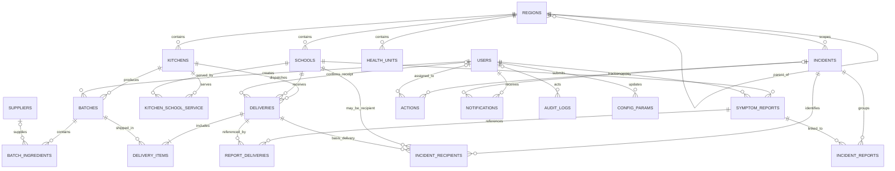
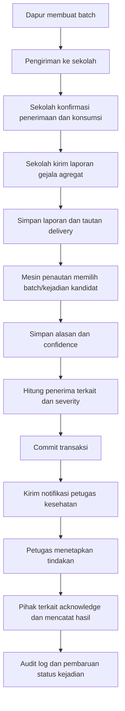

# ERD — BergiziYuk

- **Versi:** 1.0
- **Status:** Draft untuk validasi tim
- **Basis:** `prd.md`, terutama bagian Model Data dan aturan bisnis
- **Format diagram:** Mermaid ER diagram

> Diagram ini memodelkan entitas dan relasi yang disebutkan dalam PRD. Tipe kolom, UUID, timestamp teknis, dan beberapa constraint adalah usulan implementasi. Mermaid dapat dirender oleh GitHub, GitLab, VS Code dengan ekstensi Mermaid, dan renderer Mermaid lainnya.

## 1. ERD konseptual

## 2. ERD fisik dengan atribut utama

```mermaid
erDiagram
    REGIONS {
        uuid id PK
        string name
        string level
        uuid parent_id FK
    }
    USERS {
        uuid id PK
        string name
        string email UK
        string password_hash
        string role
        uuid org_ref
    }
    KITCHENS {
        uuid id PK
        string name
        uuid region_id FK
        int capacity_portions
    }
    SCHOOLS {
        uuid id PK
        string name
        uuid region_id FK
        string level
        int student_count
        uuid pic_user_id FK
    }
    HEALTH_UNITS {
        uuid id PK
        string name
        string type
        uuid region_id FK
    }
    KITCHEN_SCHOOL_SERVICE {
        uuid kitchen_id PK, FK
        uuid school_id PK, FK
    }
    SUPPLIERS {
        uuid id PK
        string name
    }
    BATCHES {
        uuid id PK
        uuid kitchen_id FK
        string code
        string menu
        datetime cooked_at
        uuid created_by FK
    }
    BATCH_INGREDIENTS {
        uuid id PK
        uuid batch_id FK
        string name
        uuid supplier_id FK
        string lot_ref
        string lot_status
    }
    DELIVERIES {
        uuid id PK
        uuid kitchen_id FK
        uuid school_id FK
        datetime dispatched_at
        datetime received_at
        uuid received_by FK
        string consumption_status
        datetime served_at
    }
    DELIVERY_ITEMS {
        uuid delivery_id PK, FK
        uuid batch_id PK, FK
        int portions
    }
    SYMPTOM_REPORTS {
        uuid id PK
        uuid school_id FK
        uuid reported_by FK
        int affected_count
        int referred_count
        string_array symptoms
        datetime eaten_at
        datetime onset_at
        datetime reported_at
        string idempotency_key
        int version
        string note
    }
    REPORT_DELIVERIES {
        uuid report_id PK, FK
        uuid delivery_id PK, FK
    }
    INCIDENTS {
        uuid id PK
        string code UK
        string status
        string severity
        uuid region_id FK
        uuid primary_kitchen_id FK
        datetime opened_at
        datetime closed_at
    }
    INCIDENT_REPORTS {
        uuid incident_id PK, FK
        uuid report_id PK, FK
        string link_reason
        string confidence
    }
    INCIDENT_RECIPIENTS {
        uuid incident_id PK, FK
        uuid school_id PK, FK
        uuid delivery_id PK, FK
        string basis
        string consumption_snapshot
        datetime notified_at
        datetime acknowledged_at
    }
    ACTIONS {
        uuid id PK
        uuid incident_id FK
        string type
        uuid assignee_user_id FK
        string status
        datetime due_at
        datetime done_at
        string note
    }
    NOTIFICATIONS {
        uuid id PK
        uuid user_id FK
        uuid incident_id FK
        string channel
        datetime sent_at
        datetime read_at
        datetime acknowledged_at
    }
    AUDIT_LOGS {
        uuid id PK
        uuid actor_id FK
        string action
        string entity
        uuid entity_id
        json payload
        datetime at
    }
    CONFIG_PARAMS {
        string key PK
        json value
        uuid updated_by FK
        datetime updated_at
    }

    REGIONS ||--o{ REGIONS : parent_of
    REGIONS ||--o{ KITCHENS : has
    REGIONS ||--o{ SCHOOLS : has
    REGIONS ||--o{ HEALTH_UNITS : has
    REGIONS ||--o{ INCIDENTS : scopes
    KITCHENS ||--o{ BATCHES : produces
    USERS ||--o{ BATCHES : creates
    BATCHES ||--o{ BATCH_INGREDIENTS : includes
    SUPPLIERS o|--o{ BATCH_INGREDIENTS : supplies
    KITCHENS ||--o{ KITCHEN_SCHOOL_SERVICE : serves
    SCHOOLS ||--o{ KITCHEN_SCHOOL_SERVICE : served_by
    KITCHENS ||--o{ DELIVERIES : dispatches
    SCHOOLS ||--o{ DELIVERIES : receives
    DELIVERIES ||--|{ DELIVERY_ITEMS : has
    BATCHES ||--o{ DELIVERY_ITEMS : included_in
    USERS o|--o{ DELIVERIES : receives_confirmation
    SCHOOLS ||--o{ SYMPTOM_REPORTS : submits
    USERS ||--o{ SYMPTOM_REPORTS : creates
    SYMPTOM_REPORTS ||--o{ REPORT_DELIVERIES : references
    DELIVERIES ||--o{ REPORT_DELIVERIES : referenced_by
    INCIDENTS ||--o{ INCIDENT_REPORTS : groups
    SYMPTOM_REPORTS ||--o{ INCIDENT_REPORTS : linked
    INCIDENTS ||--o{ INCIDENT_RECIPIENTS : identifies
    SCHOOLS ||--o{ INCIDENT_RECIPIENTS : recipient
    DELIVERIES ||--o{ INCIDENT_RECIPIENTS : delivery_basis
    INCIDENTS ||--o{ ACTIONS : tracks
    USERS o|--o{ ACTIONS : assigned
    USERS ||--o{ NOTIFICATIONS : receives
    INCIDENTS o|--o{ NOTIFICATIONS : about
    USERS o|--o{ AUDIT_LOGS : actor
    USERS ||--o{ CONFIG_PARAMS : updates
```

## 3. Cara membaca relasi penting

- **Dapur → Batch → Pengiriman:** batch diproduksi dapur; satu delivery ditujukan ke satu sekolah dan dapat berisi beberapa batch melalui `delivery_items`.
- **Dapur ↔ Sekolah:** relasi layanan ada di `kitchen_school_service`. Pengiriman ke pasangan yang tidak terdaftar harus ditolak.
- **Laporan → Pengiriman:** `report_deliveries` memungkinkan laporan merujuk ke pengiriman yang dipilih/diketahui. Laporan tetap dapat dibuat ketika pengiriman tidak diketahui.
- **Laporan → Kejadian:** `incident_reports` menyimpan alasan dan confidence tautan. Ini adalah jejak investigasi, bukan penetapan sebab.
- **Kejadian → Penerima terkait:** `incident_recipients` menyimpan sekolah, delivery dasar, dan snapshot status konsumsi ketika dikaitkan.
- **Kejadian → Tindakan/Notifikasi:** notifikasi terkirim tidak dianggap selesai; acknowledgement dan tindakan dicatat terpisah.
- **Audit:** `audit_logs` merekam siapa melakukan apa terhadap entitas mana dan kapan.

## 4. Constraint dan keputusan implementasi

1. `users.email` unik tanpa membedakan kapitalisasi.
2. `batches.code` unik minimal dalam satu dapur: `UNIQUE(kitchen_id, code)`.
3. `incidents.code` unik.
4. `delivery_items` unik untuk pasangan (`delivery_id`, `batch_id`); `portions > 0`.
5. `kitchen_school_service` unik untuk pasangan (`kitchen_id`, `school_id`).
6. `report_deliveries` unik untuk pasangan (`report_id`, `delivery_id`).
7. `incident_reports` unik untuk pasangan (`incident_id`, `report_id`).
8. `affected_count` dan `referred_count` tidak negatif. Constraint `referred_count <= affected_count` perlu disetujui sesuai definisi data.
9. Idempotency key harus memiliki cakupan unik yang diputuskan tim (misalnya per user atau per endpoint).
10. Validasi bahwa batch di `delivery_items` berasal dari dapur yang sama dengan delivery memerlukan validasi service atau constraint tambahan.
11. Foreign key `users.org_ref` pada PRD belum menentukan target tabel. Jangan mengimplementasikannya sebagai FK sebelum model organisasi diputuskan.
12. Status, severity, confidence, kategori gejala, jenis tindakan, dan `lot_status` harus memiliki enum/kontrak final yang sama antara Zod, API, dan database.

## 5. Batasan model dan hal yang belum dipastikan PRD

- PRD tidak menetapkan apakah riwayat perubahan konsumsi membutuhkan tabel tersendiri.
- PRD menyatakan riwayat tindakan append-only, tetapi belum merinci skema event. Pertimbangkan `action_events` bila setiap perubahan status/catatan harus dipertahankan.
- `incident_recipients` dalam model utama memakai kombinasi kejadian, sekolah, dan delivery. Jika satu sekolah memiliki beberapa delivery terkait dalam satu kejadian, desain ini dapat menghasilkan beberapa baris untuk sekolah yang sama; UI harus mengelompokkan per sekolah atau model perlu dinormalisasi menjadi entitas recipient dan tabel basis-link.
- PRD belum menentukan representasi confidence (label atau skor), algoritma/ambang severity, transisi status kejadian, atau kebijakan retensi.
- `health_units` disimpan sebagai master data; hubungan eksplisit user → unit kesehatan dan incident → unit penanggung jawab belum dirinci pada model data PRD. Tambahkan FK tersebut hanya setelah aturan penugasan/routing disepakati.
- Semua data demo harus fiktif. Jangan menambahkan entitas siswa individual atau data medis individual.

## 6. Alur data ringkas

## 7. Definition of Done ERD

- [ ] Semua tabel di ERD cocok dengan `database.md` dan model Prisma.
- [ ] Setiap relasi memiliki FK dan kebijakan delete/update yang jelas.
- [ ] Relasi many-to-many menggunakan tabel penghubung, bukan array ID.
- [ ] Constraint unique/check dan indeks utama tercatat.
- [ ] Model tidak menyimpan identitas siswa.
- [ ] Diagram diperbarui setiap kali schema migration mengubah entitas/relasi.
